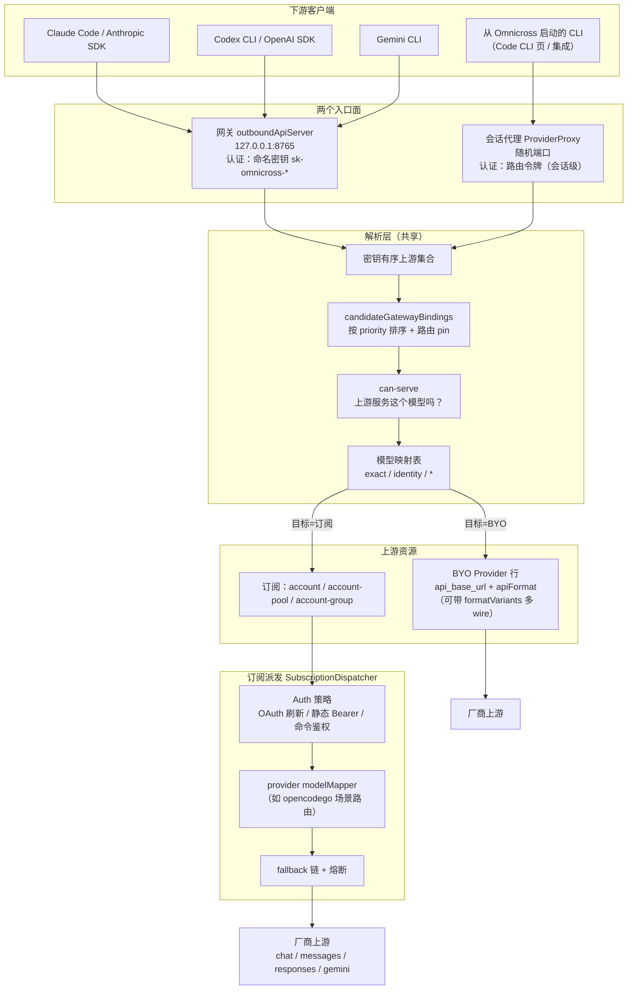
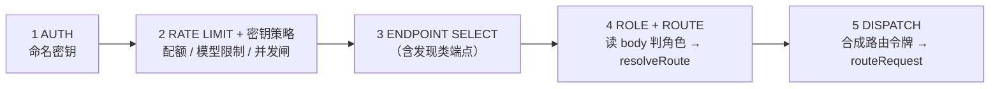
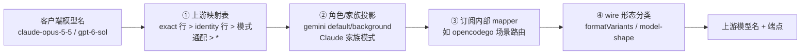
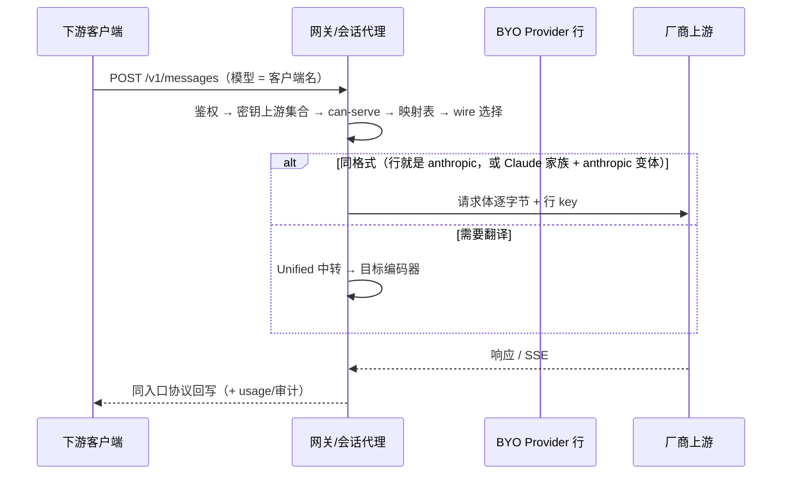
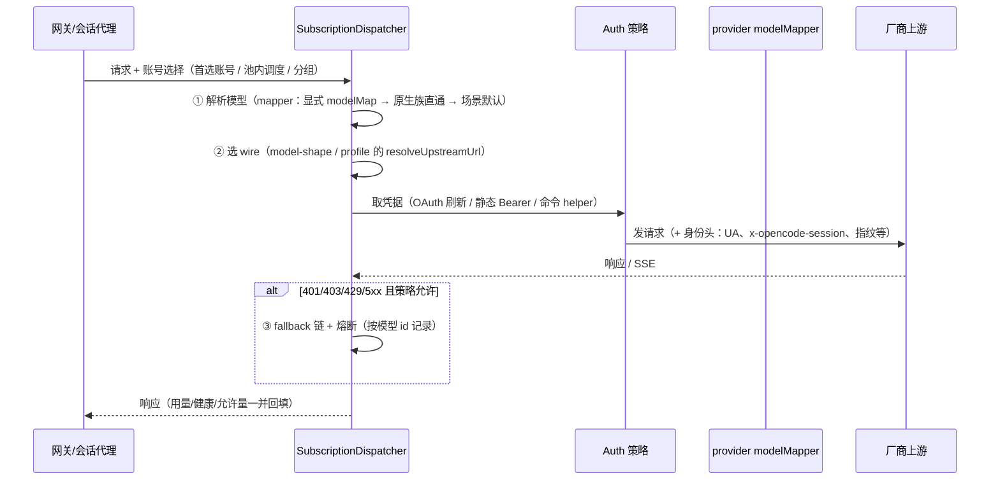
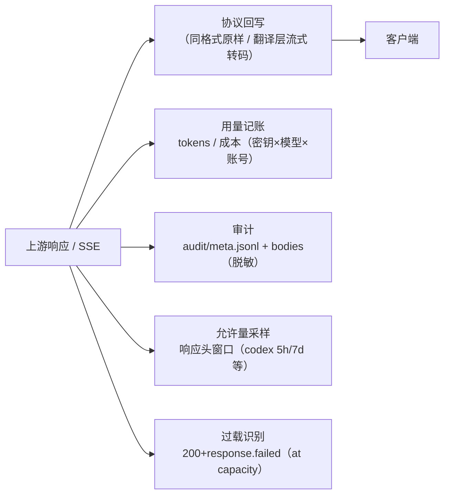

# 请求路径全景（下游客户端 ↔ 上游资源）

> 状态：以当前源码为准；历史实测日期保留在对应段落。事实来源为代码（`packages/core/src/outbound-api`、
> `packages/core/src/provider-proxy`、`packages/subscriptions`、
> `packages/daemon/src/admin`）。与 `docs/design/upstream-routing-model.md`
> （路由模型权威设计）配套阅读：本文描述**请求实际怎么流**，该文描述**为什么这样设计**。
>
> 术语：**下游** = 调用 Omnicross 的客户端（Claude Code / Codex CLI / 任意 SDK）；
> **上游** = Omnicross 转发到的真实服务（BYO Provider 行、订阅账号/分组/池）。

---

## 0. 一句话模型

一次请求要回答四个问题，各由**一个**组件回答，顺序固定：

| # | 问题 | 回答者 | 位置 |
| --- | --- | --- | --- |
| 1 | 你是谁、能不能进 | 密钥鉴权 | 网关：命名密钥；会话代理：路由令牌 |
| 2 | 这次用哪个上游 | 密钥的有序上游集合（顺序=优先级，can-serve 失败让位下一位） | 密钥行 `upstreamBinding` |
| 3 | 模型名怎么翻译 | 该上游的映射表（+ 该上游类型的内在规则） | `server.upstreamModelMappings[<上游键>]` |
| 4 | 协议怎么变 | 自动：入口端点 × 目标 wire | `formatVariants` / transformer 链 |

---

## 1. 总览图



**关键分层事实**：网关与会话代理**不是两套逻辑**。网关完成鉴权/限额后，会合成一个会话内路由令牌并把请求交给**同一个** `routeRequest`（`outboundApiRouter.ts` 第 5 阶段），因此解析、映射、转换、订阅派发只有一份实现。两者的差异仅在"令牌从哪来、生命周期多长"。

---

## 2. 入口面 A：网关（`outboundApiServer`，默认 127.0.0.1:8765）

固定流水线（`handleOutboundRequest`，顺序即代码顺序）：



### 2.1 第 1–2 阶段：鉴权与节流

- 认证 = 命名密钥（`sk-omnicross-*`）。**客户端密钥一律持有全部端点权限**——访问哪个端点由 URL 决定，不由密钥决定（`effectivePermissionsForRow`；`integration` 内部托管键保留持久化范围）。
- 逐密钥可选：请求速率窗口、配额（USD）、模型限制、并发上限（超限 429）。
- 允许量（allowance）：订阅账号的 5h/周/月窗口达到阈值时**降级或暂停**该账号参与调度（`AccountAllowanceScheduling`）；被暂停的账号在候选解析阶段就被排除。

### 2.2 第 3 阶段：发现类端点（不进入路由）

| 路径 | 用途 | 关键行为 |
| --- | --- | --- |
| `GET /v1/models` | 模型发现 | Anthropic/OpenAI 两种信封（`anthropic.modelsShape` 或按密钥自动）；列出该密钥**可见**的名字 |
| `GET /v1/codex-model-catalog` | Codex 原生目录 | 托管 Codex 集成的 `model_catalog_url` 指向它；`modelNaming.realNames` 开时给**真实上游模型**，关时给 `{models:[]}`（与内置目录合并即无操作） |
| `GET /api/oauth/usage` | Claude 用量代理 | 纯缓存读（`anthropic.proxyOauthUsage`），绝不触发上游调用 |

`realNames` 模式（`modelNaming`）下，`/v1/models` 与 Codex 目录**只列按名可路由的 id**（passthrough 目录、通配映射的目标目录、通配目标自身；exact 映射的目标不列——客户端直呼其名路由不通）。

### 2.3 第 4–5 阶段：解析与派发

1. 读请求体判**角色**（用户消息 / 后台任务；后台角色走 Gemini 角色键或 haiku 档）。
2. `resolveRoute` 用 `candidateGatewayBindings`（密钥可见、端点匹配、按 priority 排序、`x-omnicross-binding-id` 可锁单条路由）逐条尝试 **can-serve**，失败且 `fallback:'next'` 则让位下一位；全部失败时若有 legacy 直连上游则走直连中继。
3. 命中的路由给出**上游模型名**（见 §4）与目标类型，然后合成路由令牌、转发进共享 `routeRequest`。

---

## 3. 入口面 B：会话代理（`ProviderProxy`）

从应用内启动的 CLI（Code CLI 页、集成启动、key-scoped 启动）拿到的是**随机会话端口 + 路由令牌**，不是命名密钥。

- 令牌由 `addRoute(RouteContext)` 铸出，进程内有效；CLI 的 `ANTHROPIC_BASE_URL` / `OPENAI_BASE_URL` 等指向该会话端口。
- 路由上下文携带：上游类型（provider/account/account-pool/account-group）、模型或映射、认证模式（`byo` 复用 provider 行的 key；`subscription` 走订阅授权与刷新）。
- **key-scoped 启动**（`--key-id`）不是会话令牌：它把命名密钥的路由动态装进 CLI 的 config/env，语义与网关一致。
- 请求进入会话代理后，除鉴权外**完全复用** §4–§6 的解析/映射/转换链路。

---

## 4. 模型名要经过的四层（最容易误解的部分）

客户端发出的名字**不是**上游最终看到的名字。四层依次作用：



### ① 上游映射表（`server.upstreamModelMappings[<上游键>]`）

- 键 = `providerId`（BYO）或 `sub:<providerId>`（订阅）。
- 行 = `{ source, target, effort? }`；`source` 支持 exact 与 `*`。同一张表按 **exact → 含固定字符的通配规则（同级按行顺序）→ 单独的 `*` 兜底** 匹配。
- **identity 行**：上游"声明"的模型（BYO = 启用的 `modelConfigs` ∪ `models` 减去被禁用的；订阅 = 目录）会自动派生 `模型 → 同名` 行——**声明过的模型 verbatim 直发**，只有未声明的名字落到 `*` 行。这解释了"我配了 `* → X` 为什么没生效"：目标模型在声明集合内，identity 行赢了。
- **禁用模型**：UI 关闭模型写的是 `modelConfigs[].enabled=false`；派生的声明集合**会排除它**（`declaredUpstreamModels`），于是请求回落到 `*` 行。
- 显式空表 `[]` = 透传（不派生 identity 行）；`upstreamModelMappingForce` 可按上游强制只用存储行。

### ② 角色/家族投影

- Gemini 端点：映射表的 `default` / `background` 两个**角色键**投影为角色模型（不参与名字匹配）。
- Claude 订阅：家族模式匹配（`claude-opus-*` 等），版本漂移免疫。

### ③ 订阅内部 mapper（各订阅类型自己的规则）

- opencodego（`SubscriptionProviderRegistry.modelMapper`）：先看账号显式 `modelMap`；再看**原生模型族直通**（`glm-* / kimi-* / minimax-* / mimo-* / qwen* / deepseek-*` 原样发送）；否则按 `ScenarioRouter` 关键词选场景（`complex`/`think`/`long_context`/`fast`/`default`）取默认模型。场景模型的 `status:"rate-limited"`/弃用由上游决定成败。
- copilot：按模型决定 wire（Claude 系 → messages、Gemini 系 → generateContent、其余 → chat）。
- 其他订阅：各自目录 + 家族规则。

### ④ wire 形态分类（决定"发到哪个端点"，见 §5）

---

## 5. wire（端点形态）选择

同一上游可能只接受固定形态的请求。两种机制：

1. **`formatVariants`（BYO 多 wire 行）**：行声明 `{ anthropic, openai-response }` 的**基址**，主格式是 chat。
   - **按解析后的模型选**：Claude 家族（`claude-*` / `anthropic/…`）→ anthropic 变体，**逐字节 verbatim**；其它模型（通常是映射的产物，如 `deepseek/…`）→ **主 wire**，走统一中转翻译。
   - 依据：多 wire 厂商（commandcode 等）只在对应端点接受对应家族模型。
2. **订阅 wire 分类器**（`model-shape.ts`）：opencodego 的 GO/zen 半区按模型前缀选 `chat` / `anthropic` / `responses` / `gemini` 四端点之一。

路径拼接：目标根若以版本段结尾（`/v1`），入站路径的**所有**前导版本段都会被剥掉——客户端 base 带 `/v1` 造成的 `/v1/v1/messages` 折叠为单一 `/v1/messages`。

---

## 6. 变换矩阵（入口协议 × 目标协议）

| 入口 \ 目标 | anthropic | chat | responses | gemini |
| --- | --- | --- | --- | --- |
| **messages** | 原生直通（保留 server-tool 字段） | 翻译（统一中转） | 翻译 | 翻译 |
| **chat** | 翻译 | 原生 Chat 编码/清理 | 翻译 | 翻译 |
| **responses** | 翻译 | 翻译 | 原生 Responses | 翻译 |
| **gemini** | 翻译 | 翻译 | 翻译 | 原生 Gemini |

- **原生路径**：保留本协议字段；鉴权、最终模型映射和已有上游专用规整仍会执行，不能概括为所有请求逐字节透传。Chat 请求经过原生编码器清除内部回放扩展；同格式响应不必经过中转。
- **统一中转**：其余组合经 Unified 中间表示 + transformer 链。注册的编码器为 `anthropic`、`openai`、`openai-response`、`gemini`，以及 Google 订阅变体 `gemini-code-assist`、`antigravity`。
- **URL**：按 pathname 拼接端点，保留网关前缀、已有版本和查询参数；Gemini 的模型/action/`alt`、Azure 的 deployment/`api-version` 以本次最终选择为准。Gemini 原生 body 不发送路由层注入的 `model`/`stream`。
- **验证范围**：`ProviderProxy.conversionMatrix.test.ts` 覆盖四入口 × 四上游 × JSON/SSE 的 32 条两轮链路：思考、两个同名并行工具、结果回传、最终回答。这验证本地协议实现，不代表每个厂商都提供所有模型/wire 组合。
- **订阅边界**：入口支持不等于所有订阅组合都可路由；未实现组合明确报错，不宣称透明兼容。

### 思考、工具与流的完整性

- DeepSeek Chat 原生 `reasoning_content` 在 JSON 和 SSE 中均转换为 Claude thinking，并在下一轮工具结果请求中恢复。v0.6.9 的 Responses reasoning 修复不能替代这条 Anthropic ↔ Chat 回放链。
- Claude Code 2.1.280 和 2.1.308 的实际请求会在 `messages` 内发送文本 `system` turn。入口保留其角色、文本与 cache block，和顶层 `system` 一起参与转换；编码回 Anthropic 时按既有规则合并到顶层 system。已用真实 Claude Code、真实 ProviderProxy 和本地严格校验的 DeepSeek 上游验证 SSE 思考 → Read 工具 → `reasoning_content` 回传 → 最终回答；这不是 DeepSeek 线上调用证据。
- 退役裸 ID `deepseek-chat`、`deepseek-reasoner` 不再出现在内置目录；两者发送上游时均重定向为 `deepseek-flash`，并采用 Flash 的能力与思考回放规则。旧配置的显式参数和转换链优先保留；没有旧配置行时使用 Flash 配置。重定向覆盖 BYO、订阅映射/账户 remap/回退、Completion 和四种入口的原生/转换路径，不改写带发布者前缀或部署后缀的自定义 ID。独立本地 HTTP 烟测覆盖两个旧 ID × 四入口 × 四目标协议 × JSON/SSE 共 64 条两轮链路（128 次请求）。
- Anthropic thinking/signature/redacted 保持块边界；Responses encrypted reasoning 保持原 item；Google thoughtSignature 保持原 parts 与工具签名。不会伪造签名、把签名拼进可见思考、把 Google 签名当成 Anthropic 签名。
- 跨 wire 的 opaque 回放使用明确的 `extra_content` 载体（`omnicross.thinking`、`responses.reasoning`、`google.parts`）。**客户端必须保留这些扩展**；剥除未知字段的 SDK/客户端无法仅靠思考文本恢复原始签名。同格式原生回放不依赖这种跨协议扩展。
- 模型思考计划同时约束型号能力与目标 wire；显式关闭、动态预算、输出上限不能被通用默认值悄悄替换。公共 Responses 的 stream/输出上限与私有 Codex 方言分开，只有明确标记的 Codex 订阅采用其私有规则。
- 精确 Gemini 4 Argon 的 sampling 参数按官方“ignored”语义处理：转换路径省略并记录既有 dropped-field audit，保留输出上限；原生 `generationConfig` 不被改写。不把此规则泛化到所有 `gemini-4-*` 或新增本地 400。
- 并行工具按 ID/索引关联；空参数对象合法，损坏 JSON、缺少终止事件及上游 SSE error 不得伪装成正常完成。缓存和 reasoning token 用量在转换中保留，reasoning 是 output 的子集，不重复计费。
- 多候选数量在 Chat `n` 与 Gemini `candidateCount` 之间双向保留；Anthropic Messages / Responses 只有单结果语义，明确拒绝多候选请求或意外多候选响应，不再静默取 `choices[0]`。
- Google cachedContent、原生搜索/代码工具、VALIDATED、非文本输出模态等无法等价转换时，在发送前拒绝；reduced Responses 不把 hosted tools 或 grammar 自定义工具降格为普通字符串函数。原生同协议能力不因此关闭。
- 独立 `ApiConverter` 与 Completion handlers/tool loop 另有回归覆盖，不能用代理矩阵替代；Completion 保存按协议隔离的原生历史，不把服务器工具或工具结果伪装成普通用户文本。

---

## 7. 上游执行：两类目标

### 7.1 BYO Provider 行



#### 出站 Responses 输入规整（两个上游，两套规则；2026-10-09 实测）

**两个 Responses 上游的严格点互不相同**，且它们 400 时的可诊断性差得远：Command Code 只回 `invalid request error trace_id: …`（message 里什么都没有），ChatGPT 的 codex backend 会指名道姓（`Invalid 'input[15].id': … Expected an ID that begins with 'rs'`）。逐条 item 重放量出来的规则：

| | Command Code（第三方 BYO） | codex backend（ChatGPT 订阅） |
| --- | --- | --- |
| 工具调用块里夹 message / reasoning / user turn | **400**（`[call,msg,out]`；块前/块后都合法） | 200（容忍） |
| `reasoning.id` 必须 `rs_` 开头、`message.id` 必须 `msg_` 开头 | 容忍 | **400 必需** |
| 空 assistant 文本 | 曾 400（2026-10-09 当天已放宽为 200） | — |

规整统一放在**唯一出口**（`executeResponsesUpstream`，search 操作除外），但**按上游分派**——对上游本来就接受的 body 做改写是白改字节，而改字节 = 丢 prompt cache（实测未规整的一轮仍命中 95–97% 前缀，因为修复只动尾部且是确定性的）：

- `providerId !== 'codex'` → `sanitizeResponsesRequest`：把夹在工具块里的 item **搬到块之前**（真流与官方 API 的顺序 `[assistant message, call, output]`），并删掉完全无文本的 assistant message。
- `providerId === 'codex'` → `normalizeCodexItemIds`：给缺前缀的 `reasoning`/`message`/`function_call`/`custom_tool_call` id **补上前缀**（保留原 id 作后缀，保证确定性）。

**为什么必须放出口而不是生产者侧**：客户端按 item **完成顺序**记录历史，旧版本写下的 rollout 会把这个形态（以及裸 UUID 的 id）永久留在磁盘上；恢复会话时每回合原样重发，任何生产者侧的修复都够不着。所以生产者也各修一处（决定写进历史的形态），出口再兜一层（修复已存在的历史）：

- native 中继的 DSML salvage（`nativeResponsesDsml`）把重放的 call 排在 message 的 `output_item.done` **之后**（`emit.after`）——否则 codex 记录成 `[call, msg, output]`。
- 翻译层（`OpenAIResponseTransformer.transformRequestIn`）不为「只有 tool_use、无正文」的 assistant 回合发空的 `output_text: ''` item（Claude Code 的常态回合）。

#### 上游报错时日志会带上上游的原文（2026-10-09）

`[OutboundApi] request` 那行在 4xx/5xx 时多一个 `upstreamError` 字段＝**上游自己的报错正文**（截断到 2 KiB）。没有它时，"上游 400"只能靠挂 tap 代理重放请求才能诊断——而答案本来就在手里：严格网关只回 `invalid request error trace_id: …`，codex 会点名（`Invalid 'input[15].id': … Expected an ID that begins with 'rs'`）。

实现在**唯一出口** `fetchUpstream`：非 2xx 时把 body 的一个副本交给 per-request sink，再由出口 API 的路由把它写进该请求的日志行（与它的 key/provider/model 同行，便于定位）。凭据交换（`redactBodies`）的 body **完全不去读**。

两个实现陷阱（都已在代码里注释，改这里前先读）：

- **不能用 `reader.cancel()` 做"只读前 N 字节"**：`clone()` 出来的 body 是 tee，一边 cancel、另一边还在被中继消费时 **promise 永不 settle**（实测），会把 egress 卡死。要读就读到结尾（调试 trace 也是这么做的），只截断**拿去记日志**的文本。
- **sink 不能放在 per-request 复制的 `ProviderProxyDeps` 上**：`getResponsesAffinityStore` 用 **deps 对象的身份**做 `WeakMap` key（"一个依赖容器一个 store"）。复制 deps 会让每个请求拿到各自全新的空 store，多轮会话的 `previous_response_id` 全部 404（实测踩到）。sink 走 per-request 的 **RouteContext**（与既有的 `suppressAuditBodies` 同一缝）。**deps 容器的身份是承重的，不要复制它。**

#### 合成 SSE 事件必须自成一帧（2026-10-09 实测）

native 中继会在流里**插入合成事件**（DSML salvage 重放的工具调用）。上游的帧形如 `event: …` + `data: …` + 空行；转发行本身只写一个 `
`，靠上游紧随的空行收尾。**在中间插入合成事件时，必须先补一个空行把当前帧关掉**，否则两条 `data:` 落在同一帧里——SSE 规范会把它们用换行拼成一个 payload，客户端解析 `{…}
{…}` 直接失败：

```
codex_api::sse::responses Failed to parse SSE event
  error_category=Syntax error_line=2 error_column=1 payload_bytes=3273
```

**症状极具误导性**：HTTP 全是 200、daemon 日志无任何 warn、用户看到的是"没报错但任务突然中断"（流里的坏帧让客户端中止了整个回合）。它只在 salvage 真正重放调用时出现，所以是"偶发"——实测 6/6 触发的请求各含一帧坏帧。

排查手法：在上游侧（把 provider 的 `baseUrl` 指到本地 tap 代理）和下游侧**同时抓 SSE 原文**，然后扫描两条连续 `data:` 行 / 单行 payload 是否可 JSON 解析。回归测试断言的是**帧结构不变式**（一帧内不得有两条 `data:`），而不只是事件顺序——顺序测试看不见这个问题。


### 7.2 订阅（account / pool / group）

订阅目标**永远经内部 `SubscriptionDispatcher` 中转**（与路由无关，D4）：



订阅特有的横切关注点：账号健康与 401 标记、429/529 故障转移、按模型的熔断、允许量窗口（会被请求头顺带刷新）、指纹/身份头注入。

---

## 8. 回程与可观测



- 用量：`usage/` 按天分片 + 永久 rollup；密钥维度终身累计。
- 审计：`audit/audit-<日期>/meta.jsonl`（含 `model`/`provider`/状态/密钥/会话键）+ 分段脱敏的 bodies。**model 记的是解析后的上游模型名**。
- 允许量：订阅账号的窗口百分比由各 provider 的 collector 轮询（或响应头顺带刷新）；窗口到达阈值 → 调度降级/暂停。
- 过载：Codex 的 `at capacity` 是 **200 内的 SSE `response.failed`**，不是状态码；只标注不重试（账号无关）。

---

## 9. 特殊路径与遗留

| 路径 | 语义 |
| --- | --- |
| **直连 tier**（未迁移密钥的 legacy 行为） | 密钥携带 legacy `boundUpstream` 时逐字节中继到该 provider；Anthropic-Messages 请求会按 `formatVariants` 选变体目标 |
| **路由 pin** `x-omnicross-binding-id` | 把候选集合收敛为单条路由（调试/复现） |
| **图像**（`/v1/images/*`、hosted image generation） | 独立策略段 `images`；能力基于新鲜证据；运行时解析只信 `apiKeyId` |
| **搜索** | 两种前端：`native`（逐字节中继，上游自己执行）与 `managed`（本地执行 + 自己合成输出）；Codex 原生搜索走专门路由 |
| **voucher / `POST /redeem`** | 自助兑换密钥（独立段，默认关） |
| **Codex 集成配置** | 托管 `[model_providers.omnicross]` 块 + `model_catalog_url`；外部 `model_catalog_json` 在安装时被注释掉（卸载还原） |

---

## 10. 排查速查

| 现象 | 先看 |
| --- | --- |
| 用了非预期的模型 | 上游映射表的 **identity 行**是否命中（模型在声明集合内）；再看该订阅的内部 mapper |
| `must be called via ...` 类 400 | wire 选择：解析后的模型家族 vs 目标端点；路径是否出现 `v1/v1` |
| 只有 `invalid request error trace_id: …` 的 400（commandcode 等第三方 Responses） | 先看日志行的 `upstreamError` 字段（上游原文就在那里）；不够再按 §7.1 抓真实请求体逐条 item 重放 |
| 配额充足却 429 | 上游**细分窗口**（如 opencodego 的 monthly）——账号页额度条；`audit` 响应体的错误码 |
| 客户端看不到想要的模型名 | `modelNaming.realNames` 开关；`/v1/models`/Codex 目录只列按名可路由的 id |
| 请求打到哪条路由 | 审计的 `provider`/`model`/`sessionKey` + `x-omnicross-binding-id` pin 复现 |
