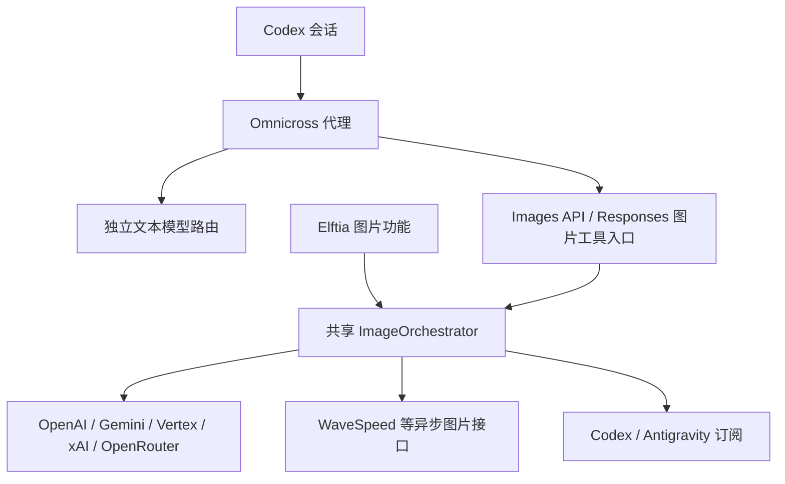

# 共享图片 Provider 实施计划

更新日期：2026-10-17。状态：主要代码与自动化集成已实现；0.6.8 发布、Elftia 正式依赖升级、桌面视觉验收和真实 Codex/上游验收待完成。

本文记录 Omnicross 与 Elftia 共享图片能力的范围、设计约束和验收要求。实施时逐项维护清单；未完成的项目不能因某一条调用链已经可用而视为完成。

## 1. 用户确认的目标

1. 将 Elftia 中可复用的图片 provider 协议实现迁入 Omnicross，避免两个项目分别维护。
2. Codex 的文本模型和图片 provider 可以独立配置：文本使用第三方接口时，图片仍可调用另行配置的图片接口，无须依赖官方 Codex 订阅。
3. Codex 订阅图片能力继续作为 Elftia 的一个图片 provider，与 API Key provider 并列。
4. 同步修改 **Omnicross 桌面 App 的图片 provider 页面**，让用户可以完成配置、模型路由和状态检查，不能只完成后端。
5. 保留 GPT Image 2.5 两个模型的支持：`gpt-image-2.5-flare`、`gpt-image-2.5-sunburst`，并处理两个项目的模型目录与调用入口。

## 2. 已核实的起点

以下是源码分析结论，不等同于已完成真实上游生图验收。

- Elftia 的 `packages/core/src/media-adapters/image/index.ts` 已注册 8 个适配器：`openai`、`geminiAistudio`、`vertex`、`xai`、`openrouter`、`wavespeed`、`wavespeed-relay`、`codex-subscription`。
- Elftia 的 `codex-subscription-runtime.ts` 已在进程内使用 Omnicross 的订阅图片 provider 和 `ImageOrchestrator`。这一方向已经接通，无须重新搭建，也无须强制经过 daemon HTTP。
- Omnicross 已有 `ImageProvider`、`ImageProviderRegistry`、`ImageOrchestrator`、任务事件、图片资源、引用及两套对外入口。
- 通用 provider 接口允许任意实例 ID，但 `ImagesServerConfig` 和 daemon 装配仍围绕 Codex、Antigravity 两种订阅 provider。
- Elftia 启动 Codex 使用的 resident `ProviderProxy` 已有扩展操作分发入口，但初始化尚未注入图片处理器和运行时。
- Elftia 的订阅图片目录仍只声明 `gpt-image-2`，需要同步 GPT Image 2.5 模型。
- Omnicross 当前图片设置页写死了两种订阅 provider，需要同步扩展为实例和路由管理。
- 现有 Responses 图片工具参数白名单未接收 `tools[].model`，与 Images API 顶层 `model` 是不同的适配点。

## 3. 职责划分

| 内容 | 归属 |
| --- | --- |
| 图片公共请求、能力、事件和稳定错误类型 | Omnicross contracts |
| 第三方图片协议、编排、输入输出处理、任务取消 | Omnicross 可嵌入运行时 |
| Codex、Antigravity 登录与私有图片协议 | Omnicross subscriptions |
| 配置持久化、凭证解析、存储后端、管理接口 | daemon 或嵌入宿主 |
| Omnicross provider 配置和模型路由页面 | Omnicross UI / 桌面 App |
| Elftia 设置、会话、历史、提示词模板、作品和画廊 | Elftia |
| Elftia 产品中继令牌与产品权限 | Elftia |

Elftia 通过宿主端口提供凭证、文件持久化和公开图片 URL。Omnicross 不导入 Elftia 的业务服务；Elftia 不重新实现上游通用协议。



共享运行时必须同时支持进程内调用和 daemon HTTP 调用。不能要求 Elftia 为了调用本机运行时而额外启动 daemon，再绕行 HTTP。

## 4. Provider 实例和模型路由

必须区分三个概念：

- **Provider 类型**：协议实现，例如 OpenAI Images、Gemini、WaveSpeed、Codex 订阅。
- **Provider 实例**：用户配置的一组地址、凭证和协议参数。同一类型可存在多个实例。
- **公开模型路由**：用户或客户端请求的模型 ID，映射到 provider 实例及实际的上游模型 ID。

语义示例，具体字段名由实现决定：

```text
公开图片模型 illustration
  -> provider 实例 studio-images
  -> provider 类型 openai-images
  -> 上游模型 gpt-image-2.5-sunburst
```

要求：

- [x] 支持同一协议配置多个不同接口地址和凭证。
- [x] 支持不同实例拥有同名上游模型，通过公开路由消除歧义。
- [x] 图片默认模型和文本默认模型相互独立。
- [x] 支持模型别名与显式上游模型映射，检测不存在的目标及冲突。
- [x] 保持旧订阅模型路由和 GPT Image 2.5 配置兼容，明确迁移规则。
- [x] Provider 能力按实际模型和路由计算，不能以 provider 名称推断全部能力。
- [x] 凭证使用现有安全存储或宿主解析端口；管理读取与日志不得暴露秘密。
- [x] 对显式选择的 provider / 模型保持准确语义，不静默换成其他付费来源或模型。

## 5. Codex 的两种图片入口

### 5.1 独立生图工具

Codex 的独立 `image_gen.imagegen` 调用 Images API 的 generations / edits。该入口应独立于文本模型路由解析图片 provider。

- [x] daemon Images API 可使用 API Key 图片 provider。
- [x] Elftia 内嵌代理挂载相同的图片处理器和共享运行时。
- [x] 会话临时路由具有可信调用身份、权限、资源隔离和正确清理行为。
- [x] 覆盖 API key、Route Lease、Elftia 进程内会话等实际身份路径，不能伪造 outbound API key 身份来绕过限制。
- [ ] 核验所用 Codex 版本的工具可见性、启动配置和请求格式；不能以设置了兼容 header 代替验收。
- [x] 文本请求和图片请求分别使用对应上游凭证，取消和会话结束能清理图片任务。

### 5.2 Responses 内置图片工具

Responses 的 `tools: [{ type: 'image_generation' }]` 由主模型选择调用，再由 Omnicross 执行图片任务并回填 `image_generation_call`。

- [x] 支持工具中的 `model` 字段，通过图片路由选择模型和 provider。
- [x] 不混淆 Responses 顶层文本模型与图片工具模型。
- [x] 保持非流式结果、SSE 事件、错误、用量和引用行为一致。
- [x] 分别验收 native Responses 与从其他协议转换的路径。
- [x] 检查现有 native profile、outbound key 等限制；扩展时保证身份及引用隔离不被绕过。
- [x] 明确图片工具与托管搜索等工具的组合约束，不能静默丢弃其中一项。
- [x] 多轮编辑保持引用、过期处理及上下文语义，不能仅返回一张图片就宣称完整兼容。

跨协议托管工具属于独立阶段，不能用独立 Images API 已可调用来替代其验收。

## 6. 各类 Provider 的迁移要求

| Provider | 迁移重点 |
| --- | --- |
| OpenAI / OpenAI 兼容 Images | 标准 generations / edits、JSON / multipart、GPT Image 2.5 模型与参数；核对现有 Elftia Responses 实现，不能原样照搬 |
| Gemini AI Studio | 原生图片输入输出、宽高比和分辨率、模型能力 |
| Vertex | 复用适用的 Gemini 内容转换；保留宿主认证和 endpoint 差异 |
| xAI | 按原生图片协议处理生成、编辑和模型限制 |
| OpenRouter | 按其聊天图片输出协议处理，不假定兼容 Images API |
| WaveSpeed | 提交任务、保留 job ID、轮询、下载、取消与超时；避免已接受任务被重试再次提交 |
| 官方中继 | 通用传输可复用；Elftia 产品令牌和业务权限仍在 Elftia |
| Codex / Antigravity 订阅 | 继续复用现有实现、账户池、能力证据及调度；不得回归 |

通用约束：

- [x] 统一内部 generate / edit 请求，但保留 provider 专有且必要的参数空间。
- [x] 显式描述多图输入、遮罩、透明背景、输出格式、批量与流式预览能力。
- [x] 将 GPT 特定的尺寸合法性与全局资源上限分离，允许其他 provider 的宽高比和分辨率。
- [x] 不静默忽略不支持的参数，不伪造流式预览、usage 或成本。
- [x] 输出图片必须经过格式和资源限制验证；远程下载按宿主策略处理重定向和访问范围。
- [ ] 异步任务在上游接受后保留状态，重试以继续等待或取回结果为主，避免重复计费。
- [x] AbortSignal、超时和任务生命周期覆盖提交、轮询、下载和释放。

## 7. Omnicross 桌面 App 页面必须同步修改

图片 provider 页面属于本次交付范围，后端完成而页面无法配置不算完成。

- [x] Provider 实例列表：新增、编辑、删除、启用状态及协议类型。
- [x] 接口地址与凭证配置：复用现有凭证处理习惯，已保存凭证不能被无意清空或展示原文。
- [x] 实例模型管理：配置上游模型、公开模型路由、别名和默认图片模型。
- [x] API Key 和订阅 provider 使用一致的管理入口，并清楚显示各自认证来源。
- [x] 显示可用性、未配置、待验证、不可用和失败原因，区分静态声明与实际验证结果。
- [x] 显示模型的生成、编辑等能力；不把所有 provider 的能力都画成相同。
- [x] 验证功能区分无消耗检查与真实生图；真实生图需清楚提示会调用上游并可能消耗额度。
- [x] 清楚展示文本路由与图片路由的独立关系，避免用户认为修改图片 provider 会修改文本模型。
- [x] 删除、禁用或改名实例时处理现有路由引用，不能留下无提示的失效默认模型。
- [x] 配置保存失败、热重载失败及不可用状态有可操作的反馈，不能显示成功但运行时仍使用旧配置。
- [x] 保留订阅账户状态、已有模型覆盖项和其他图片设置，完善中英文文案。
- [ ] 完成桌面实际页面验证，包括空配置、多个实例、重复模型名和错误恢复。

## 8. Elftia 接入要求

- [x] 现有图片 provider 配置、请求和结果通过薄适配层映射到共享运行时。
- [ ] 保持桌面与 server host 的能力一致，避免只修改 Electron 路径。
- [x] 保持现有图片数量、宽高比、分辨率、附件、历史和 providerMessage 等产品契约。
- [x] 作品存储、会话历史、资源发布和产品中继权限留在 Elftia。
- [x] Codex 订阅 provider 同步 GPT Image 2.5 目录和模型选择。
- [x] Elftia 启动 Codex 的实际会话接通独立图片路由。
- [ ] 同步依赖和公开导出，保证验证使用的是当前源码构建结果。

## 9. 实施顺序

1. **配置与共享运行时**：确定实例、模型路由和凭证端口；兼容旧配置；提供可嵌入装配入口。
2. **首个完整闭环**：实现标准 OpenAI Images provider，接通 daemon、桌面配置页、Elftia 映射和 Codex 独立生图。
3. **迁移其余通用 provider**：逐项迁入并回归 Elftia 请求及结果语义，处理异步任务和公开资源端口。
4. **Responses 工具扩展**：支持 `tools[].model`、可信会话身份和跨协议工具调用；分别处理工具组合与多轮编辑。
5. **整合与交付检查**：核对全部清单，更新使用和开发文档，验证桌面及两个宿主入口。

每阶段都应可运行、可检查；未完成项继续保留，不通过缩小描述把整个迁移宣称为完成。

## 10. 验收场景

- [ ] Codex 文本走第三方 provider，生成图片走单独配置的 API Key 图片 provider。
- [ ] 同一个图片实例可以被 Elftia 图片功能、Codex 独立工具和 daemon Images API 复用。
- [ ] Codex 订阅仍可供 Elftia 生成及编辑图片，不依赖 daemon。
- [x] 两个相同协议的实例使用不同地址、密钥和同名上游模型，路由准确且凭证不串用。
- [x] GPT Image 2.5 Flare / Sunburst 的显式选择不会被旧模型覆盖项替换。
- [x] Responses 顶层文本模型和工具图片模型不同，实际执行模型符合各自配置。
- [x] 取消、超时、上游失败、已接受任务后的重试不造成重复提交或资源泄漏。
- [x] 不支持的编辑、遮罩、尺寸、透明背景等请求得到明确错误。
- [x] 不同调用身份的图片引用和临时资源相互隔离。
- [ ] 桌面页面配置后实际调用生效；重启后保存结果正确；旧配置可以继续使用。
- [x] 原有文本代理、订阅图片、模型目录、鉴权和资源清理没有回归。

## 11. 工作约束与验证记录

- 保留当前工作区中已有的 GPT Image 2.5 改动及用户文档，不回滚无关修改。
- 源码和文档按 UTF-8 读取；修改后检查严格解码、diff、语法和无关整文件变化。
- 为跨协议、鉴权、路由、异步任务和配置迁移编写有实际意义的回归测试。
- 迭代时运行相关最小检查，整合时运行类型检查和必要构建；避免反复执行无关完整套件。
- 自动化测试优先使用本地可控上游；没有实际调用过的真实 provider 不记录为已验证。
- 不因文档清单本身触发真实付费生图、Git 提交或发布；这些动作分别遵循会话授权和项目规则。

实施记录：勾选表示源码实现及相应自动化检查已覆盖，不表示真实账号或安装包验收通过。未完成的交付与现场验证继续保持未勾选。

### 2026-10-17 实现与验证快照

- 共享运行时已提供七种 API 协议；API 实例、凭证来源、公开模型映射、别名、模型能力和默认路由已接入 daemon。新增和编辑凭证使用已有安全存储；禁用来源及热重载读取有回归测试。API Key 池当前只选首个启用 key，尚未接入图片请求的池轮换。
- Responses native/转换路径、工具模型独立选择、可信调用身份、多轮引用与 SSE 输出有自动化覆盖。不能据此声称本机 Codex 已显示工具并完成真实生成。
- Omnicross Images 页面已加入实例 CRUD、凭证编辑、模型映射与别名管理；React DOM 测试覆盖新增、保存失败/重试及空密钥保留。当前自动化环境没有可用浏览器，实际桌面视觉检查未完成。
- Elftia 六个通用 API 适配器复用共享运行时，产品中继保留宿主权限逻辑。desktop resident Codex proxy 已装配媒体桥；server 复用 core 适配器，但当前没有 resident Codex CLI listener，也没有新增该 listener。
- 旧内置 OpenAI 图片项从文本模型迁移到专用 Images 模型。自定义 `openaiResponses` 文本生图配置不会擅自换模型，也不会把文本模型提交到 Images API；需要用户改用专用 Images 模型。未复刻旧的非标准 `modalities` 请求。
- GPT Image 2.5 两个 ID、`xhigh`/`max`、Nano Banana 2.1 Interactions、Gemini 4 文本参数均已加入。官方 MiMo 旧文本 ID 读取迁移和旧会话路由解析仅作用于已核对的官方地址，第三方 ID、ASR/TTS 保留。
- WaveSpeed 提交后只轮询重试，不自动重复付费 POST；取消会停止本地等待。job ID 目前保存在运行中的任务内，尚未实现重启后恢复或向客户端暴露持久任务句柄。
- 先前相关 Omnicross 套件通过 559 项（另 1 项跳过）；本轮新增/修复后的定向套件通过 99 项。Elftia 本轮 13 个文件、84 项相关测试通过。最终类型、构建与编码结果在完成后补记。
- 验证 Elftia 时临时使用本地构建产物路径，未更改生产依赖、用户配置或执行真实付费生图。

最终补记：

- Omnicross contracts/core/subscriptions/CLI/chatgpt-web/daemon/UI 分包类型检查通过；daemon 构建和 UI 构建通过。构建与类型检查同时运行时曾遇到清理 dist 引起的声明暂时缺失，构建结束后 UI 类型检查重跑通过。
- 最新路由迁移、lease 预检和 API 能力定向套件 4 个文件、40 项通过；Elftia 最后补充的线协议套件 8 项通过。上述数字与其他定向套件有重叠，不相加作为独立总数。
- Elftia 图片 core 的本地产物类型检查通过；完整 desktop 检查剩 2 个无关错误（semver 声明、创作插件测试断言），完整 server 检查剩 4 个无关错误（3 个创作测试、CLI runtime `getVersions`）。本次代码引入的质量类型和返回类型问题已修正，不能将完整宿主类型检查记为全绿。
- Elftia 本次修改文件 ESLint 无错误；扩大的目录扫描有 7 个现存警告。格式检查通过。两仓 461 个修改/未跟踪文本文件严格 UTF-8、JSON、替换字符、新增 BOM 与禁止引用检查无异常；`git diff --check` 通过。
- 已读取本机 Codex 版本：0.163.0；未启动真实生成会话验证工具可见性。没有可用浏览器执行桌面视觉验收。
- 版本一致性检查和 6 项 release-version 测试通过。六个 0.6.8 npm 包已在系统临时目录 `omnicross-images-release-f78c9a8f03ec4e92913a670525473114` 打包，未发布。
- 提交前合入远端更新后，发现旧模型迁移会在 Responses 请求体校验前读取 Provider。已将迁移移到校验之后，补充退役模型的无效请求回归；Responses compact、输入净化、图片生产链路及路由相关 5 个文件、91 项测试通过。

### 交付依赖

Omnicross 已用仓库版本脚本准备为 **0.6.8**，包含新的公共图片导出；0.6.7 已经发布，不能用同版本承载本次新导出。Elftia 当前生产锁定 **0.6.4**，标准构建尚不能消费这些新导出。

正式交付需按顺序发布 0.6.8 的 contracts/core/subscriptions/cli-launcher/ui/daemon，再将 Elftia 根包、各宿主/运行包清单、版本校验脚本和 lockfile 同步到已发布的精确版本，并运行正式依赖检查。不得伪造未发布包的 lockfile integrity，也不将本地源码别名留作生产依赖。

发布与重装共享依赖需要本次会话明确授权，依据 Elftia `CLAUDE.md` 的任务边界。用户已明确授权 Git 提交与推送；本次按该范围交付，不包含 npm 发布或重装共享依赖。

### 2026-10-17 补充：Google 模型目录

用户要求将新模型和下架模型一起更新。已读取官方模型卡及退役表，确认：

- Nano Banana 2.1 的正式 ID 为 `gemini-nano-banana-2.1`，需要处理 Interactions 图片接口。
- Gemini 4 的当前正式 ID 为 `gemini-4-argon`；该模型输出文本，不支持图片生成，不能放入图片 provider 的可生图目录。
- `gemini-3.1-flash-image-preview`、`gemini-3-pro-image-preview` 已于 2026-06-25 关闭；`gemini-2.5-flash-image-preview` 已于 2026-01-15 关闭。
- 图片稳定版包括 `gemini-nano-banana-2.1`、`gemini-3.1-flash-lite-image`、`gemini-3.1-flash-image`、`gemini-3-pro-image`。
- 官方并未宣布所有 Gemini 2.5 稳定版关闭；2.5 文本稳定版限制新用户访问，2.5 图片稳定版的退役日期为 2027-03-15。保留历史用户的显式配置，推荐目录使用新模型。
- API 公开目录不能作为 Antigravity 或其他订阅账户有权调用的证据，订阅仍执行独立能力检查。

新增检查项：

- [x] 更新 Google 文本模型元数据、默认推荐目录和 Gemini 4 参数兼容。
- [x] 更新图片目录和退役 preview 的配置迁移，保留第三方自定义实例的显式模型映射。
- [x] 覆盖 Nano Banana 2.1 的实际请求与响应格式、编辑、多参考图和分辨率选项。
- [x] 同步 Elftia 模型目录与 Omnicross 桌面选择项。

参考：[Google 模型目录](https://ai.google.dev/gemini-api/docs/models)、[退役表](https://ai.google.dev/gemini-api/docs/deprecations)、[图片生成](https://ai.google.dev/gemini-api/docs/image-generation)。

## 12. 参考入口

- `packages/contracts/src/image-generation-types.ts`
- `packages/core/src/image-generation/`
- `packages/core/src/outbound-api/imagesServerConfig.ts`
- `packages/daemon/src/image-generation/`
- `packages/ui/src/features/images/`
- `packages/cli-launcher/src/proxy-env/codex-proxy-env.ts`
- Elftia：`packages/core/src/media-adapters/image/`
- Elftia：`packages/desktop/app/main/bootstrap/capabilities-completion.ts`
- [OpenAI 图片生成文档](https://developers.openai.com/api/docs/guides/image-generation)
